# ╔══════════════════════════════════════════════════════════════════════════════╗
# ║  SUPER MARIO WORLD 2: YOSHI'S ISLAND · NATIVE ARM64 & ANDROID RECOMPILATION ║
# ╚══════════════════════════════════════════════════════════════════════════════╝

```text
  ___ _   _ ____  _____ ____    __  __    _    ____  ___ ___  
 / ___| | | |  _ \| ____|  _ \  |  \/  |  / \  |  _ \|_ _/ _ \ 
 \___ | | | | |_) |  _| | |_) | | |\/| | / _ \ | |_) || | | | |
  ___) | |_| |  __/| |___|  _ <  | |  | |/ ___ \|  _ < | | |_| |
 |____/ \___/|_|   |_____|_| \_\ |_|  |_/_/   \_\_| \_\___\___/ 
      __   _____  ____  _   _ ___ _ ____    ___ ____  _        _    _   _ ____  
      \ \ / / _ \/ ___|| | | |_ _| (____)  |_ _/ ___|| |      / \  | \ | |  _ \ 
       \ V / | | \___ \| |_| || || |        | |\___ \| |     / _ \ |  \| | | | |
        | || |_| |___) |  _  || || |___     | | ___) | |___ / ___ \| |\  | |_| |
        |_| \___/|____/|_| |_|___|_____|   |___|____/|_____/_/   \_\_| \_|____/ 
```

<div align="center">

[](https://github.com/hectorx24/yoshi-island-widescreen)
[](https://github.com/hectorx24/yoshi-island-widescreen)
[](https://github.com/hectorx24/yoshi-island-widescreen)
[](https://github.com/hectorx24/yoshi-island-widescreen)
[-yellow.svg?style=for-the-badge)](https://github.com/hectorx24/yoshi-island-widescreen)
[](https://github.com/hectorx24/yoshi-island-widescreen)

**Recompilación nativa estática en código abierto de *Super Mario World 2: Yoshi's Island* (USA v1.1) para arquitecturas modernas ARM64.**

</div>

---

> [!IMPORTANT]
> ### ⚖️ AVISO LEGAL Y CONDICIONES DE DISTRIBUCIÓN
> 
> **Este es un proyecto independiente, no oficial y sin afiliación, patrocinio ni respaldo de Nintendo Co., Ltd.**
> 
> *Yoshi's Island*, *Super Mario*, sus personajes, gráficos, música, efectos de sonido y demás elementos originales pertenecen a **Nintendo Co., Ltd.** y a sus respectivos titulares de derechos.
> 
> **1. Ninguna ROM ni Material Comercial Incluido:**
> Este repositorio **NO incluye, NO distribuye ni enlaza ninguna ROM**, archivo ejecutable comercial original de Nintendo, recursos protegidos extraídos de ellos (sprites, pistas SPC700, mapas binarios) ni parches que redistribuyan contenido protegido sin autorización.
> 
> **2. Propiedad Personal y Privada:**
> Cada usuario debe aportar su propia copia legalmente adquirida de la ROM original (*Super Mario World 2: Yoshi's Island - USA v1.1*, SHA-256: `bd763c1a56365c244be92e6cffefd318780a2a19eda7d5baf1c6d5bd6c1b3e06`) para compilar y ejecutar el proyecto en su propio equipo para uso estrictamente personal y privado.
> 
> **3. Contenido del Repositorio:**
> Este repositorio contiene exclusivamente código fuente original de reimplementación (C, Java, Python), herramientas de desarrollo, scripts de compilación, especificaciones de geometría de capas y documentación técnica.
> 
> **4. Capturas Ilustrativas (Uso Legítimo / Fair Use):**
> Las capturas de pantalla técnicas contenidas en esta documentación se publican exclusivamente con fines ilustrativos, informativos, educativos y comparativos para documentar las mejoras técnicas y visuales desarrolladas por el proyecto.

---

## 🎮 1. Características Principales

```text
┌────────────────────────────┬────────────────────────────────────────────────────────┐
│ Característica             │ Descripción Técnica                                    │
├────────────────────────────┼────────────────────────────────────────────────────────┤
│ Widescreen Panorámico Real │ Viewport extendido hasta 420×224 píxeles (16:9/20:9).  │
│ Centro SNES Byte-Idéntico  │ Los 256×224 píxeles centrales son 100% idénticos al    │
│                            │ hardware original de Super Nintendo (cero desync).     │
│ Preset "Island Cinema"     │ Suavizado CRT subpíxel 0.10/0.80/0.10 e iluminación    │
│                            │ contextual 2D-HD respetando el arte en tiza original.  │
│ Partículas Ambientales     │ Polvo al aterrizar, gotas de agua y brasas de lava     │
│                            │ generadas determinísticamente en capa de presentación. │
│ Frecuencia a 120 Hz        │ Presentación desacoplada a 120 Hz en Android mientras  │
│                            │ la física y audio SNES corren a 60.0988 Hz exactos.    │
│ Traducción al Español      │ Textos integrados en memoria con ortografía completa   │
│                            │ (á, é, í, ó, ú, ñ, ¿, ¡) basada en Traducciones Wave.  │
│ Controles Táctiles y Mando │ Insets seguros anti-recorte y soporte normalizado para │
│                            │ mandos Bluetooth/USB (Xbox, PlayStation, Switch Pro).  │
│ Háptica Inmersiva          │ Respuestas de vibración háptica ante saltos y daño.    │
└────────────────────────────┴────────────────────────────────────────────────────────┘
```

---

## 📸 2. Comparativas Técnicas: Antes y Después

> *Nota: Todas las capturas mostradas han sido generadas por el arnés de pruebas del proyecto con fines de auditoría técnica y documentación.*

### A. Comparativa de Filtros de Imagen (Misma Escena de Juego)

Comparación lado a lado del renderizado de la imagen en los tres modos de visualización disponibles:

| 1. Sin Filtro (Píxeles Crudos 1×1) | 2. Con Suavizado Subpíxel (Soft CRT) | 3. Preset Final "Island Cinema" (2D-HD) |
| :---: | :---: | :---: |
| 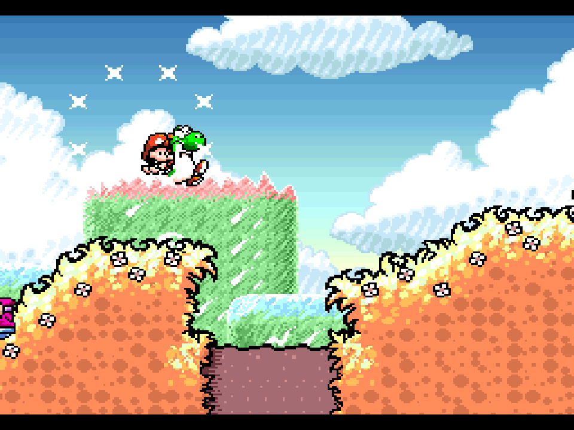 | 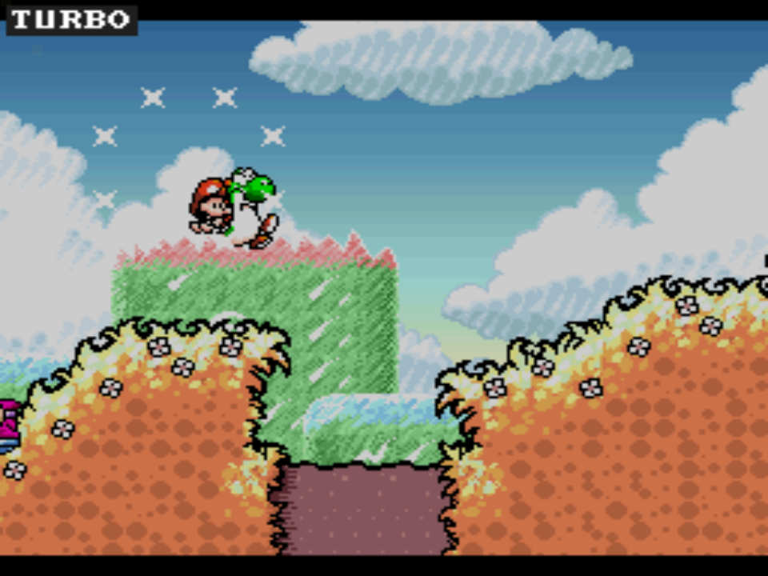 | 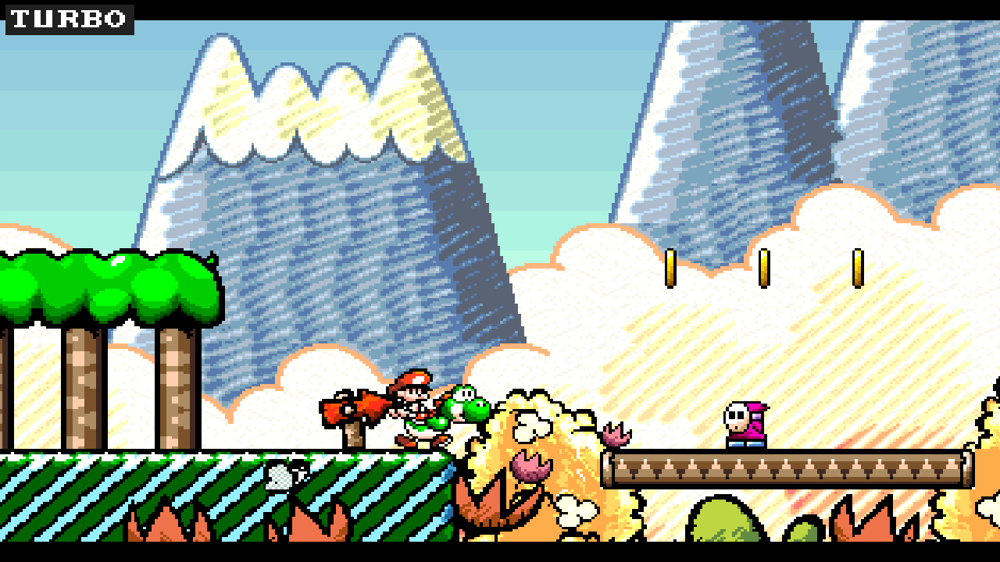 |
| *Píxel art crudo escalado directamente sin filtrado (bordes pixelados duros).* | *Suavizado horizontal subpíxel que recrea la suavidad del fósforo de un CRT.* | *Iluminación contextual 2D-HD con bloom térmico en fuentes de luz y partículas.* |

---

### B. Comparativa de Aspect Ratio: 4:3 Tradicional vs Panorámico Nativo

| Formato Original SNES (4:3 con Barras Negras) | Formato Panorámico Nativo Extendido (16:9 / 20:9) |
| :---: | :---: |
| 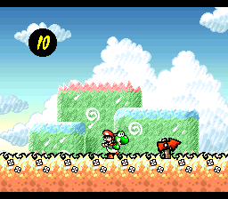 | 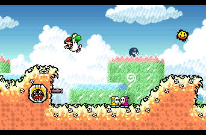 |
| *Resolución original de 256×224 píxeles obligando a pilares negros laterales.* | *Resolución panorámica real de 342×224 píxeles renderizando geometría auténtica.* |

---

### C. Batallas contra Jefes: Encuadre 4:3 vs Arena Panorámica

| Arena de Jefe en 4:3 (Original) | Arena de Jefe Panorámica Extendida (Mejorada) |
| :---: | :---: |
| 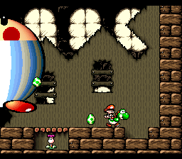 | 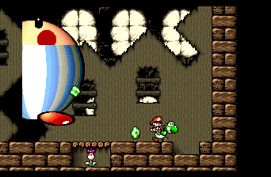 |
| *El marco original limita la visibilidad horizontal durante la batalla.* | *Composición extendida que muestra la arena completa sin romper el gameplay.* |

---

### D. Galería de Entornos 16-Bits en Widescreen Nativo

Verificación técnica de la extensión gráfica en los distintos biomas del juego (sin costuras, parpadeos ni bordes negros accidentales):

| 🌿 Praderas y Colinas (Mundo 1-1) | 🪨 Caverna Subterránea con Chomp Rock (Mundo 1-2) |
| :---: | :---: |
| 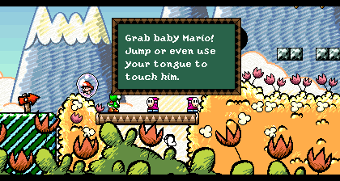 | 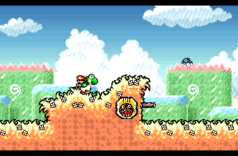 |

| 🌴 Jungla y Bosque Tropical (Mundo 3-1) | 💧 Lagos y Agua (Mundo 3-7) |
| :---: | :---: |
| 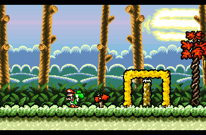 | 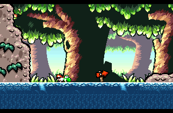 |

| ❄️ Montaña y Cumbres Nevadas (Mundo 5-1 / 5-2) | 🌋 Castillo de Bowser y Lava (Mundo 6-8) |
| :---: | :---: |
| 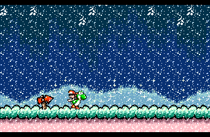 | 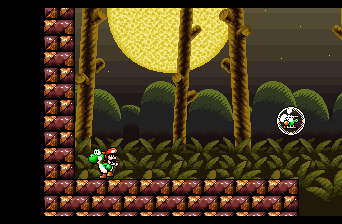 |

| ⭐ Nivel Extra Secreto (Extra 1) | 🍄 Nivel Extra Avanzado (Extra 6) |
| :---: | :---: |
| 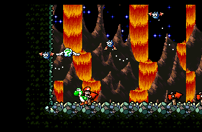 | 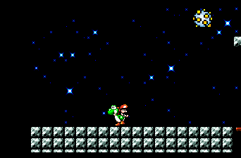 |

---

## 🛠️ 3. Estructura del Repositorio

```text
yoshi-island-widescreen/
├── android/                 # Código fuente de la aplicación Android (Java, JNI, Manifest)
│   ├── AndroidManifest.xml  # Configuración Android con bandera 120 Hz y orientaciones
│   ├── java/                # Clases Java (YoshiActivity, Controls, Haptics, Achievements)
│   └── res/                 # Iconos adaptativos en arte completo (sin bordes blancos)
├── cmake/                   # Módulos de configuración CMake y parches modulares
├── config/                  # Mapeo de bancos y cabeceras de recompilación
├── docs/                    # Documentación técnica y capturas comparativas
│   ├── captures/            # Capturas de verificación técnica (Fair Use)
│   └── ENGINEERING_NOTES.md # Notas de arquitectura e ingeniería inversa limpia
├── src/                     # Código fuente C de interoperabilidad y renderizado
│   ├── display_geometry.c   # Cálculo de viewports panorámicos (16:9 y 20:9)
│   ├── game_rtl.c           # Runtime de enlace de llamadas recompiladas
│   ├── presentation.c       # Shader "Island Cinema", iluminación 2D-HD y partículas
│   ├── yoshi_spanish.c      # Inyector de subtítulos y traducción al español en memoria
│   └── yoshi_scene_map.c    # Política de composición visual por tipo de escena
├── tests/                   # Scripts de regresión y verificación determinista
└── tools/                   # Herramientas de compilación, empaquetado y diagnóstico
```

---

## 🚀 4. Guía de Compilación

### Requisitos Previos
- **macOS** (Apple Silicon / Intel) o **Linux** (x86_64 / aarch64)
- **Clang / GCC** compatible con C11
- **Python 3.9+**, **CMake 3.22+**, **Ninja**, **Rust 1.80+**
- **Android NDK r25+** y **Android SDK Platform 35** (exclusivo para compilar el APK)
- Copia legal y privada de la ROM original de Super Nintendo:
  - Archivo: `Super Mario World 2 - Yoshi's Island (USA) (Rev 1).smc`
  - SHA-256: `bd763c1a56365c244be92e6cffefd318780a2a19eda7d5baf1c6d5bd6c1b3e06`

### Compilación para Escritorio (macOS / Linux)

```bash
# 1. Clonar el repositorio
git clone https://github.com/hectorx24/yoshi-island-widescreen.git
cd yoshi-island-widescreen

# 2. Compilar binarios de recompilación nativos
sh tools/build.sh

# 3. Ejecutar suite de pruebas de verificación de integridad
sh tools/test.sh

# 4. Lanzar el juego en tu equipo suministrando tu propia ROM
./build/YoshiIsland --no-launcher --rom "/ruta/a/tu/ROM.smc"
```

### Generación del APK de Android

```bash
# Generar e instalar el APK optimizado para arquitectura ARM64
python3 tools/build_android.py --rom "/ruta/a/tu/ROM.smc"
```

El instalador final firmado se generará en:  
`build/android-arm64/YoshiIsland_Widescreen_v1.1_Final.apk`

---

## 📜 5. Licencias y Reconocimientos

- **SNESRecomp Runner & Host:** Licencia [PolyForm Noncommercial 1.0.0](https://polyformproject.org/licenses/noncommercial/1.0.0/).
- **Yoshi's Island Disassembly:** Licenciado bajo [GNU General Public License v3.0](https://www.gnu.org/licenses/gpl-3.0.html).
- **Código Original de Adaptación y Shaders:** Licencia [MIT](https://opensource.org/licenses/MIT).
- **Traducción al Español:** Basada en la localización de *Traducciones Wave* para SNES, inyectada en memoria en tiempo de ejecución.
- **Nintendo Co., Ltd.:** Todos los derechos de propiedad intelectual, marcas, nombres y contenidos audiovisuales originales de *Super Mario World 2: Yoshi's Island* pertenecen a Nintendo. Este proyecto es una obra de ingeniería inversa para interoperabilidad y preservación sin fines lucrativos ni comerciales.
