<div align="center">

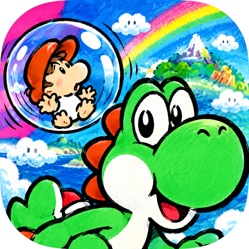

# ╔══════════════════════════════════════════════════════════════════════════════╗
# ║  SUPER MARIO WORLD 2: YOSHI'S ISLAND · NATIVE ARM64 & ANDROID RECOMPILATION ║
# ║                           ·  B E T A   3  ·                                  ║
# ╚══════════════════════════════════════════════════════════════════════════════╝

```text
  ___ _   _ ____  _____ ____    __  __    _    ____  ___ ___  
 / ___| | | |  _ \| ____|  _ \  |  \/  |  / \  |  _ \|_ _/ _ \ 
 \___ | | | | |_) |  _| | |_) | | |\/| | / _ \ | |_) || | | | |
  ___) | |_| |  __/| |___|  _ <  | |  | |/ ___ \|  _ < | | |_| |
 |____/ \___/|_|   |_____|_| \_\ |_|  |_/_/   \_\_| \_\___\___/ 
      __   _____  ____  _   _ ___ _ ____    ___ ____  _        _    _   _ ____  
      \ \ / / _ \/ ___|| | | |_ _| (____)  |_ _/ ___|| |      / \  | \ | |  _ \ 
       \ V / | | \___ \| |_| || || |        | |\___ \| |     / _ \ |  \| | | | |
        | || |_| |___) |  _  || || |___     | | ___) | |___ / ___ \| |\  | |_| |
        |_| \___/|____/|_| |_|___|_____|   |___|____/|_____/_/   \_\_| \_|____/ 
```

[](https://github.com/hectorx24/yoshi-island-widescreen)
[](https://github.com/hectorx24/yoshi-island-widescreen)
[](https://github.com/hectorx24/yoshi-island-widescreen)
[](https://github.com/hectorx24/yoshi-island-widescreen)
[](https://github.com/hectorx24/yoshi-island-widescreen)
[-yellow.svg?style=for-the-badge)](https://github.com/hectorx24/yoshi-island-widescreen)
[](https://github.com/hectorx24/yoshi-island-widescreen)

**Recompilación nativa estática en código abierto de *Super Mario World 2: Yoshi's Island* (USA v1.1) para arquitecturas modernas ARM64.**

</div>

---

> [!IMPORTANT]
> ### ⚖️ AVISO LEGAL Y CONDICIONES DE DISTRIBUCIÓN
> 
> **Este es un proyecto independiente, no oficial y sin afiliación, patrocinio ni respaldo de Nintendo Co., Ltd.**
> 
> *Yoshi's Island*, *Super Mario*, sus personajes, gráficos, música, efectos de sonido y demás elementos originales pertenecen a **Nintendo Co., Ltd.** y a sus respectivos titulares de derechos.
> 
> **1. Ninguna ROM ni Material Comercial Incluido:**
> Este repositorio **NO incluye, NO distribuye ni enlaza ninguna ROM**, archivo ejecutable comercial original de Nintendo, recursos protegidos extraídos de ellos (sprites, pistas SPC700, mapas binarios) ni parches que redistribuyan contenido protegido sin autorización.
> 
> **2. Propiedad Personal y Privada:**
> Cada usuario debe aportar su propia copia legalmente adquirida de la ROM original (*Super Mario World 2: Yoshi's Island - USA v1.1*, SHA-256: `bd763c1a56365c244be92e6cffefd318780a2a19eda7d5baf1c6d5bd6c1b3e06`) para compilar y ejecutar el proyecto en su propio equipo para uso estrictamente personal y privado.
> 
> **3. Contenido del Repositorio:**
> Este repositorio contiene exclusivamente código fuente original de reimplementación (C, Java, Python), herramientas de desarrollo, scripts de compilación, especificaciones de geometría de capas y documentación técnica bajo licencias de código abierto.
> 
> **4. Capturas Ilustrativas (Uso Legítimo / Fair Use):**
> Las capturas de pantalla técnicas contenidas en esta documentación se publican exclusivamente con fines ilustrativos, informativos, educativos y comparativos para documentar las mejoras técnicas y visuales desarrolladas por el proyecto.

---

## 🎮 1. Novedades y Características de la Beta 3

```text
┌────────────────────────────┬────────────────────────────────────────────────────────┐
│ Característica             │ Descripción Técnica Implementada                       │
├────────────────────────────┼────────────────────────────────────────────────────────┤
│ Widescreen Panorámico Real │ Viewport extendido hasta 420×224 píxeles (16:9/20:9).  │
│ Centro SNES Byte-Idéntico  │ Los 256×224 píxeles centrales son 100% idénticos al    │
│                            │ hardware original de Super Nintendo (cero desync).     │
│ Sombras de Contacto 2D     │ Sombra de contacto dinámicamente proyectada bajo Yoshi │
│ (inspirado en PixelLight)  │ y entidades, anclándolos físicamente al terreno.       │
│ Sistema Extendido de       │ Polvo de despegue/carrera/aterrizaje, salpicaduras y   │
│ Partículas Deterministas   │ ondas en agua, brasas de lava y destellos al colectar. │
│ Preset "Island Cinema"     │ Suavizado CRT subpíxel 0.10/0.80/0.10 e iluminación    │
│ (2D-HD Remaster)           │ contextual por bioma respetando el arte en tiza.       │
│ Frecuencia a 120 Hz        │ Presentación desacoplada a 120 Hz en Android mientras  │
│                            │ la física y audio SNES corren a 60.0988 Hz exactos.    │
│ Traducción al Español      │ Textos integrados en memoria con ortografía completa   │
│                            │ (á, é, í, ó, ú, ñ, ¿, ¡) basada en Traducciones Wave.  │
│ Controles Táctiles y Mando │ Insets seguros anti-recorte y soporte normalizado para │
│                            │ mandos Bluetooth/USB (Xbox, PlayStation, Switch Pro).  │
│ Háptica Inmersiva          │ Respuestas de vibración háptica ante saltos y daño.    │
└────────────────────────────┴────────────────────────────────────────────────────────┘
```

---

## 📸 2. Comparativas Técnicas: Antes y Después (Juego Base vs Beta 3 Final)

> *Nota: Todas las comparativas mostradas a continuación han sido capturadas en el motor nativo de la Beta 3, recortadas a las 208 líneas de exploración activas de SNES (eliminando por completo las franjas negras superior e inferior) y presentadas estrictamente en formato de 2 columnas para contrastar el comportamiento del juego original frente a la remasterización final.*

### 1. Prólogo y Cinemáticas Narrativas (`SCENE_TYPE_D_STORYBOOK`)
| JUEGO BASE (SNES Original 4:3 con Vacíos Negros) | BETA 3 FINAL (Encuadre Panorámico de Cuento Ilustrado 16-Bit) |
| :---: | :---: |
| 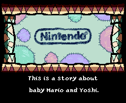 | 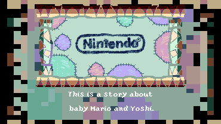 |
| *La cinemática original queda encerrada en un recuadro 4:3 con bandas negras vacías.* | *Composición extendida con textura de libro ilustrado en mosaico 16-bit sin barras negras.* |

---

### 2. Mapa Mundial de la Isla Yoshi (`SCENE_TYPE_C_MAP`)
| JUEGO BASE (SNES Original 4:3 Limitado) | BETA 3 FINAL (Extensión Continua de Océano y Pergamino) |
| :---: | :---: |
| 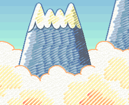 | 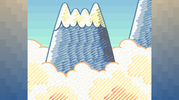 |
| *El mapa de la isla queda acotado a los 256 píxeles centrales con columnas oscuras.* | *Transición panorámica fluida con mosaico de textura de pergamino oceánico de 16-bits.* |

---

### 3. Praderas y Colinas (Mundo 1-1, `SCENE_TYPE_A_WIDESCREEN`)
| JUEGO BASE (SNES Original 4:3, 256×208 Píxeles) | BETA 3 FINAL (Widescreen 16:9 Panorámico Real, 370×208 Píxeles) |
| :---: | :---: |
| 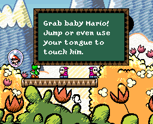 | 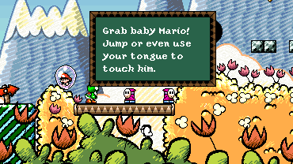 |
| *Campo visual estrecho; enemigos y plataformas aparecen súbitamente al avanzar.* | *Amplitud visual panorámica completa con tilesets originales de colinas y nubes sin pop-in.* |

---

### 4. Gameplay de Acción en Colinas (Mundo 1-2, Yoshi y Bebé Mario)
| JUEGO BASE (Píxeles Crudos Planos, Sin Sombras ni Partículas) | BETA 3 FINAL (Remaster 2D-HD Island Cinema con Sombra y Polvo) |
| :---: | :---: |
| 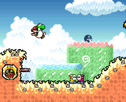 | 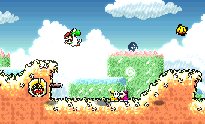 |
| *Renderizado plano tradicional; Yoshi flota visualmente sobre el escenario.* | *Sombra de contacto oscura bajo los pies, partículas de polvo al correr/saltar y bloom.* |

---

### 5. Caverna Subterránea con Chomp Rock (Mundo 1-2)
| JUEGO BASE (Paleta Plana Convencional de SNES) | BETA 3 FINAL (Iluminación Fría de Caverna y Sombra de Contacto) |
| :---: | :---: |
| 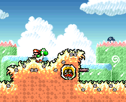 | 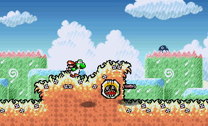 |
| *Misma tonalidad cálida superficial aplicada dentro de las grutas subterráneas.* | *Iluminación fría de cueva (228, 232, 246), mayor contraste y sombra anclada bajo la roca.* |

---

### 6. Batalla contra Jefe: Burt the Bashful (Mundo 1-4, `SCENE_TYPE_B_BOSS`)
| JUEGO BASE (4:3 Nativo Central) | BETA 3 FINAL (Arena Centrada con Mosaico de Ladrillos 16-Bit) |
| :---: | :---: |
| 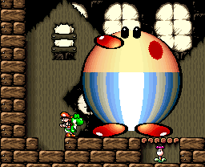 |  |
| *El formato 4:3 introduce franjas negras vacías en pantallas modernas.* | *Burt 100% íntegro en el centro; pilares laterales en mosaico de piedra 16-bit sin cortes ni fantasmas.* |

---

### 7. Selva Tropical y Palmeras (Mundo 3-1)
| JUEGO BASE (SNES Original 4:3 Estrecho) | BETA 3 FINAL (Widescreen 16:9 con Iluminación Solar Tropical) |
| :---: | :---: |
| 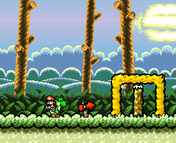 | 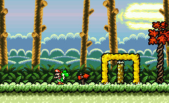 |
| *Vegetación densa comprimida en 256 píxeles con iluminación plana.* | *Extensión de dosel selvático en 16:9 con tonalidad solar tropical (248, 255, 242).* |

---

### 8. Entorno Acuático y Lagos (Mundo 3-7)
| JUEGO BASE (Superficie de Agua Estática) | BETA 3 FINAL (Ondas Concéntricas y Salpicaduras de Agua) |
| :---: | :---: |
| 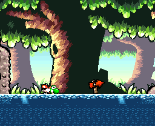 | 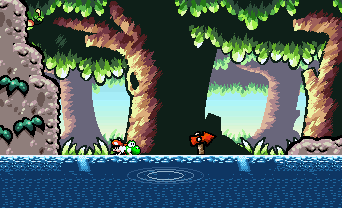 |
| *El agua carece de interactividad física con Yoshi o las criaturas acuáticas.* | *Partículas de ondas expansivas en el agua y salpicaduras reactivas a los movimientos.* |

---

### 9. Cumbres Nevadas y Ventisca Alpina (Mundo 5-1)
| JUEGO BASE (Blanco Plano Sin Profundidad) | BETA 3 FINAL (Contraste Alpino Invernal y Copos de Nieve Flotantes) |
| :---: | :---: |
| 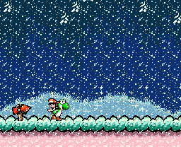 | 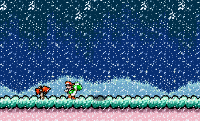 |
| *Nieve deslumbrante que quema los detalles de los personajes y el fondo.* | *Protección de blancos, tono frío (240, 246, 255) y partículas deterministas de ventisca.* |

---

### 10. Castillo de Bowser y Fosos de Lava (Mundo 6-8)
| JUEGO BASE (Lava Estándar Convencional) | BETA 3 FINAL (Resplandor Radiante Ígneo y Ascuas Flotantes) |
| :---: | :---: |
| 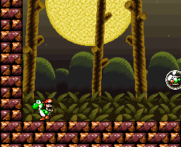 | 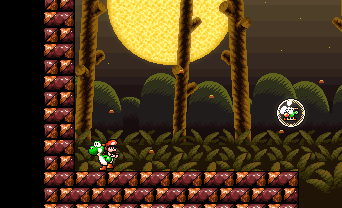 |
| *La lava se dibuja como un bloque naranja plano sin emisión de calor ni luz.* | *Iluminación ambiental ígnea (245, 218, 212), bloom emisivo sobre el magma y ascuas flotantes.* |

---

### E. Modos de Filtrado Visual e Iluminación (Gameplay Activo, Nivel 1-2)

| 1. Píxeles Crudos (Sharp 1×1) | 2. Suavizado Subpíxel (Soft CRT) | 3. Acabado Final "Island Cinema" (2D-HD) |
| :---: | :---: | :---: |
|  |  |  |
| *Píxel art puro sin filtrado (bordes duros 1:1).* | *Suavizado horizontal subpíxel 0.10/0.80/0.10 emulando fósforo CRT.* | *Iluminación contextual por bioma, sombras de contacto, polvo y bloom.* |


## 🛠️ 3. Estructura del Repositorio

```text
yoshi-island-widescreen/
├── android/                 # Código fuente de la aplicación Android (Java, JNI, Manifest)
│   ├── AndroidManifest.xml  # Configuración Android con bandera 120 Hz y orientaciones
│   ├── java/                # Clases Java (YoshiActivity, Controls, Haptics, Achievements)
│   └── res/                 # Iconos adaptativos en arte completo (sin bordes blancos)
├── cmake/                   # Módulos de configuración CMake y parches modulares
├── config/                  # Mapeo de bancos y cabeceras de recompilación
├── docs/                    # Documentación técnica, activos y capturas comparativas
│   ├── assets/              # Iconos oficiales en alta resolución (icon.png)
│   ├── captures/            # Capturas de verificación técnica (Fair Use)
│   └── ENGINEERING_NOTES.md # Notas de arquitectura e ingeniería inversa limpia
├── src/                     # Código fuente C de interoperabilidad y renderizado
│   ├── display_geometry.c   # Cálculo de viewports panorámicos (16:9 y 20:9)
│   ├── game_rtl.c           # Runtime de enlace de llamadas recompiladas
│   ├── presentation.c       # Shader "Island Cinema", sombras PixelLight y partículas
│   ├── yoshi_spanish.c      # Inyector de subtítulos y traducción al español en memoria
│   └── yoshi_scene_map.c    # Política de composición visual por tipo de escena
├── tests/                   # Scripts de regresión y verificación determinista
└── tools/                   # Herramientas de compilación, empaquetado y diagnóstico
```

---

## 🚀 4. Guía de Compilación y Descarga de la Beta 3

### Instalador Android Listo para Usar
- El paquete firmado oficial de la **Beta 3** se genera en:  
  `build/android-arm64/YoshiIsland_Widescreen_Beta_3.apk`

### Requisitos de Compilación desde el Código Fuente
- **macOS** (Apple Silicon / Intel) o **Linux** (x86_64 / aarch64)
- **Clang / GCC** compatible con C11
- **Python 3.9+**, **CMake 3.22+**, **Ninja**, **Rust 1.80+**
- **Android NDK r25+** y **Android SDK Platform 35** (para compilar la APK)
- Copia legal y privada de la ROM original de Super Nintendo:
  - Archivo: `Super Mario World 2 - Yoshi's Island (USA) (Rev 1).smc`
  - SHA-256: `bd763c1a56365c244be92e6cffefd318780a2a19eda7d5baf1c6d5bd6c1b3e06`

### Compilación para Escritorio (macOS / Linux)

```bash
# 1. Clonar el repositorio
git clone https://github.com/hectorx24/yoshi-island-widescreen.git
cd yoshi-island-widescreen

# 2. Compilar binarios nativos
sh tools/build.sh

# 3. Ejecutar suite de pruebas de verificación de integridad y biomas
sh tools/test.sh
python3 tools/test_beta3_biomes.py --rom "/ruta/a/tu/ROM.smc"

# 4. Lanzar el juego en tu equipo suministrando tu propia ROM
./build/YoshiIsland --no-launcher --rom "/ruta/a/tu/ROM.smc"
```

### Generación del APK de Android (Beta 3)

```bash
# Compilar, optimizar y firmar el instalador para dispositivos Android ARM64
python3 tools/build_android.py --rom "/ruta/a/tu/ROM.smc"
```

El instalador final firmado se ubicará en:  
`build/android-arm64/YoshiIsland_Widescreen_Beta_3.apk`

---

## 📜 5. Licencias y Reconocimientos

- **SNESRecomp Runner & Host:** Licencia [PolyForm Noncommercial 1.0.0](https://polyformproject.org/licenses/noncommercial/1.0.0/).
- **Yoshi's Island Disassembly:** Licenciado bajo [GNU General Public License v3.0](https://www.gnu.org/licenses/gpl-3.0.html).
- **Código Original de Adaptación y Shaders:** Licencia [MIT](https://opensource.org/licenses/MIT).
- **Traducción al Español:** Basada en la localización de *Traducciones Wave* para SNES, inyectada en memoria en tiempo de ejecución.
- **Técnicas de Remasterizado Visual:**
  - Sombras cuantizadas inspiradas en [PixelLight](https://github.com/SalvaPixel/PixelLight).
  - Rampas de iluminación y preservación tonal inspiradas en [LutLight2D](https://github.com/NullTale/LutLight2D).
  - Filtrado subpíxel y corrección de escalado inspirados en [perfect-retroshaders](https://github.com/sinedied/perfect-retroshaders).
  - Ondas y salpicaduras inspiradas en [Godot 4 Pixelated Water Shader](https://github.com/taillight-games/godot-4-pixelated-water-shader).
- **Nintendo Co., Ltd.:** Todos los derechos de propiedad intelectual, marcas, nombres y contenidos audiovisuales originales de *Super Mario World 2: Yoshi's Island* pertenecen a Nintendo. Este proyecto es una obra de ingeniería inversa para interoperabilidad y preservación sin fines lucrativos ni comerciales.
